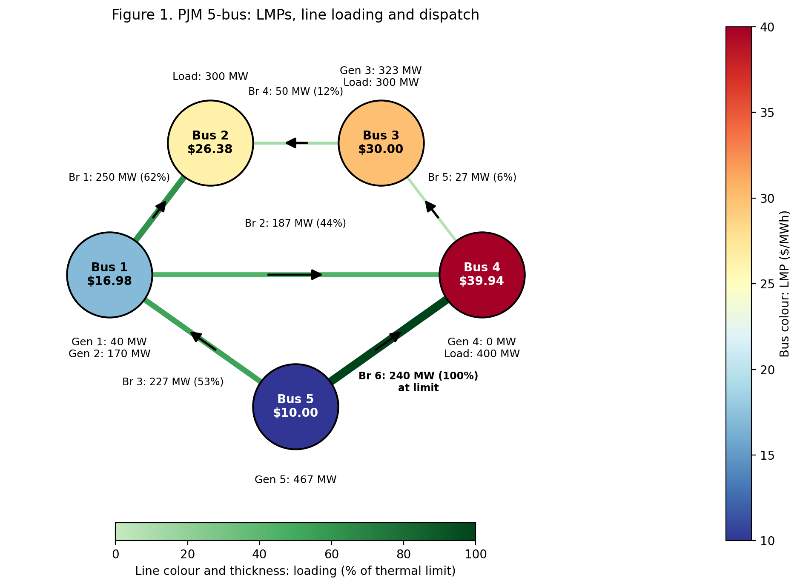
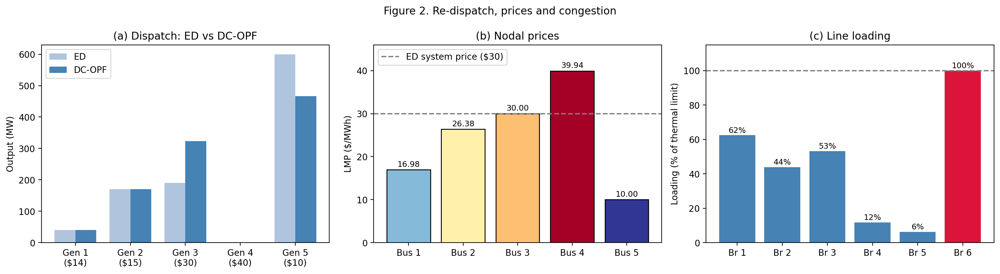

# DC-OPF on the PJM 5-Bus Network: Congestion, Dispatch and LMPs

Economic dispatch versus network-constrained DC optimal power flow (DC-OPF) on the PJM 5-bus test case, built in Python with Pyomo and HiGHS. The project shows what transmission congestion costs, how it re-dispatches generation, and how it produces different electricity prices (locational marginal prices, LMPs) at different buses. Every result is cross-checked against PYPOWER.

## Key results



*Figure 1. PJM 5-bus network. Bus colours and labels show locational marginal prices (LMPs); line colours and thickness indicate loading relative to thermal limits; arrows show power-flow direction.*

**Table 1. Key quantitative results**

| Result | Value |
|---|---|
| ED operating cost | $14,810/h |
| DC-OPF operating cost | $17,479.90/h |
| Cost increase due to network constraints | $2,669.90/h (+18.0%) |
| Binding line | Branch 6 (240 MW), 100% loaded |
| LMPs (Bus 1 to 5) | $16.98, $26.38, $30.00, $39.94, $10.00/MWh |
| Branch 6 shadow price | $62.32/h per MW of additional capacity |

### Key findings

- **Congestion increases operating cost:** Network constraints raise the modeled cost by $2,669.90/h, or 18%. The resulting dispatch shifts 133.5 MW from the cheapest generator to a more expensive unit.
- **Prices vary by location:** The binding transmission constraint limits the least-cost dispatch, producing different LMPs across the five buses.
- **Transmission capacity has marginal value:** Branch 6 reaches its 240 MW limit and has a shadow price of $62.32/h per additional MW of capacity at the current operating point.



*Figure 2. (a) Re-dispatch from ED to DC-OPF. (b) Nodal prices against the ED system price. (c) Line loading, with Branch 6 at its limit.*

## What is in this repo

```
pjm5-dcopf/
├── README.md
├── requirements.txt
├── notebooks/
│   ├── 01_dcopf_pyomo.ipynb              # ED, DC-OPF, LMPs and shadow prices (Pyomo + HiGHS)
│   └── 02_dcopf_pypower_reference.ipynb  # same case in PYPOWER, used as the reference solution
└── images/
```

The theory behind the project (economic dispatch, DC power flow, congestion, duals and LMPs) is written up on my [website](https://vesuvius-khatiwada.super.site/dc-optimal-power-flow-using-pyomo/).

## How to run

```bash
git clone https://github.com/vjkhtw/pjm5-dcopf.git
cd pjm5-dcopf
pip install -r requirements.txt
jupyter notebook notebooks/01_dcopf_pyomo.ipynb
```

The Pyomo notebook contains PYPOWER's reference values for the comparison. The second notebook regenerates them if you change the case data. 

## Limitations

This is a lossless DC model for a single period with linear costs and base-case line limits only. There are no N-1 contingencies, reserves, unit commitment or bid-based offers, so the prices are simplified day-ahead-style LMPs, not PJM's actual prices.

## Data

[IEEE PES Power Grid Library](https://github.com/power-grid-lib/pglib-opf), `pglib_opf_case5_pjm` (v23.07), based on F. Li and R. Bo, "Small Test Systems for Power System Economic Studies," IEEE PES General Meeting, 2010. Licensed CC BY 4.0.

## Learning resources

* [Modelling Energy Systems](https://www.modelling-energy-systems.org/stable/): A useful resource for learning optimization modelling and Pyomo.
* [AI for Optimal Power Flow](https://colab.research.google.com/github/climatechange-ai-tutorials/optimal-power-flow/blob/main/AI_for_Optimal_Power_Flow.ipynb), Climate Change AI: An introduction to AC-OPF and machine-learning approaches to power system optimization. This tutorial also introduced me to PYPOWER and the PJM five-bus test system.
* [Introduction to Optimal Power Flow](https://invenia.github.io/blog/2021/06/18/opf-intro/), Invenia: A helpful conceptual introduction to OPF and the role of network constraints in economic dispatch.
* [Optimal Power Flow (DC and AC OPF)](https://www.energy-markets-school.dk/documents/2017/Chatzivasileiadis/Optimal%20Power%20Flow%20%28DC%20and%20AC%20OPF%29%20v1.pdf), Stavros Chatzivasileiadis: Lecture slides covering DC-OPF and AC-OPF formulations, including the mathematical foundations of network-constrained optimization.

## Author

Vesuvius Khatiwada, [portfolio](https://vesuvius-khatiwada.super.site/)
